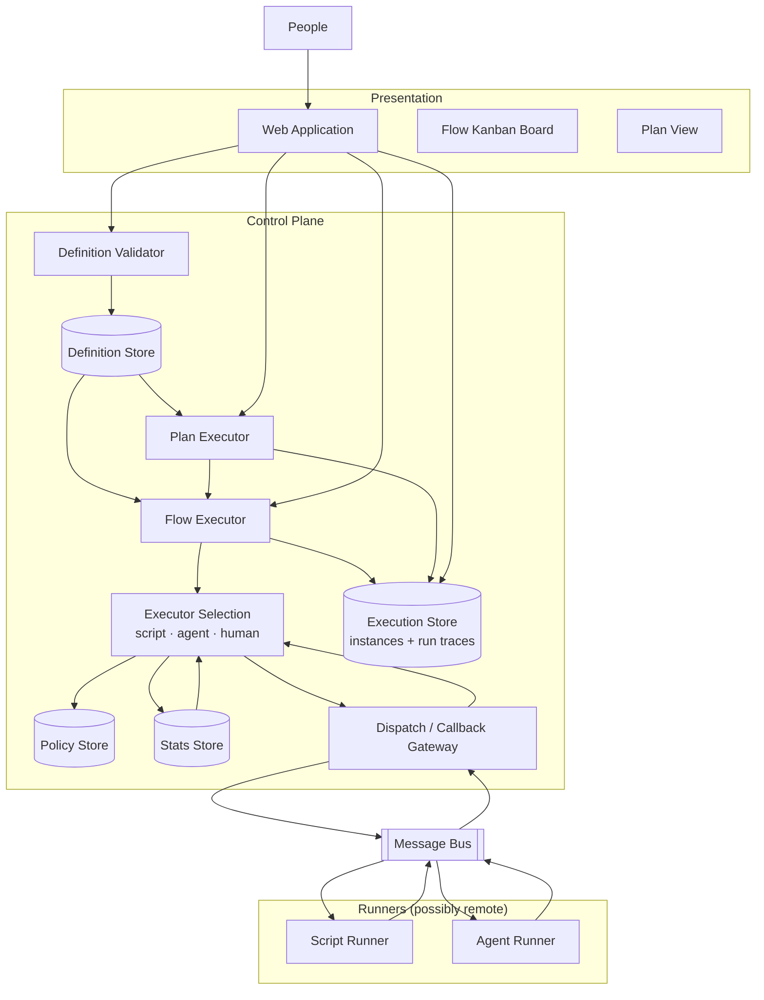

# Architecture: Flow Execution Platform

This document describes the key components of the platform and how they fit together. It
builds on `vision.md`: the platform applies one idea — a definition of ordered units, an
executor that runs them, a step history that lives with the instance — at two levels, **Plan** and
**Flow**. Within a flow, one further idea applies to every node: **each node is executed by the
executor that fits its task — script, agent, or human — chosen for the character of the work,
not for its historical score.** A node may declare a fallback for when its chosen executor
cannot complete; measurement is used for calibration and for deciding when a task should be
re-authored, not to pick the executor per run. Autonomy is an explicit run-level input: an
`autonomous` run lets the engine drop human executors unless policy requires a human.

The architecture is deliberately split into a **control plane** (definitions, policies,
executors, state) and **runners** that may execute on other machines, connected by a
**message bus**.

---

## Component overview

---

## Key components

### 1. Definition Store

Holds **plan definitions** and **flow definitions** as JSON, together with their versions.

- A flow definition groups **nodes** into stages and substages; each node declares its
  **executor** — script, agent, or human — plus any fallback, and names its successor(s) via
  `next`, so order, parallelism, and error routing are explicit. The executor is chosen for
  the character of the task, not from runtime statistics.
- A plan definition is a set of nodes, each pairing a material goal with the flow that
  should achieve it; each node names its successor(s) the same way.
- Definitions are immutable-by-version: a run always refers to the exact version it started
  with.
- The store is the source of truth for *what should run*, never for *what is running*.

### 2. Definition Validator

Checks every definition against its schema before it is stored or used.

- Rejects invalid definitions early; nothing runs against them.
- Validates executor declarations: every node has at least one executor, and its fallback, if
  any, is well formed.
- Guarantees the executor can rely on the shape of what it loads.
- Can be used by the web application for live validation while authoring.

### 3. Policy Store

Holds **flow policies** — the dynamic half of execution. The definition declares the node's
executor; the policy decides how that executor's output is judged *today*.

- Per executor kind: an acceptance **bar** (minimum confidence) and whether its verdict is
  **binding** or advisory.
- **Escalation** settings: when the chosen executor's output may fall back to the node's
  declared fallback, and the sampling rate that keeps calibration data flowing.
- **Human requirement**: `requireHuman` on a node or annotation class keeps the human
  executor even in an autonomous run (e.g. `risk: structural`).
- **Rules** match node annotations (`when: { risk: 'structural' }`) and override the
  defaults — first match wins.
- Policy tunes quality and escalation behavior; it never swaps the executor the task calls
  for. Raising a confidence bar never requires a new definition version.

### 4. Stats Store

Collects the runtime statistics used for calibration and re-authoring. Every completed node
run feeds its run trace in; the store aggregates per node and per annotation class.

- **Agreement** between an automated verdict and the human check that samples it (outcome +
  label).
- **Escalations** — executor runs that fell below their bar.
- **Coverage** — the share of acceptance criteria formalized into deterministic checks.
- Persists alongside the execution store and is exposed at `GET /api/stats`.

### 5. Plan Executor

Orchestrates **flow instances** as the units of a larger initiative.

- Loads a plan definition and starts a **plan instance**.
- Creates a flow instance for each plan node's goal, tracks whether it is running, paused, or
  ended, and follows the node's `next` label to the next node.
- Treats each flow as a black box: it does not inspect the steps inside.

### 6. Flow Executor

Orchestrates the **nodes** of a single flow.

- Loads a flow definition and starts a **flow instance**.
- Owns the node state machine: running, paused, ended. A node executed by a human stays
  running until the person responds.
- Hands each node to the **executor selector** and routes on the node's outcome and `next`
  exactly as before — nodes fail fast, errors route by code, unexpected errors pause the
  flow.
- Appends everything that happens — including the live run trace — to the flow instance's
  steps.

### 7. Executor Selection & Escalation

Realizes "each node is executed by the executor that fits its task". The executor is
authored on the node, based on the character of the work:

- **Script** — the task can be abstracted into specific rules and a deterministic sequence
  of steps.
- **Agent** — the task resists rules but has a fixed toolset and, ideally, a result that can
  be verified by deterministic criteria or logic.
- **Human** — neither can carry the work, and the value is expert input (context, decisions,
  taste, feedback) or accountability.

The selection component:

- Reads the node's declared executor and the run's **autonomy** setting and runs the active
  executors; it does **not** choose the executor from runtime statistics.
- In an `autonomous` run, drops the human executor so the next cheaper executor carries the
  work — unless policy sets `requireHuman` for the node or its annotation class.
- Does **not gate on confidence** in an autonomous run: a verdict without an error is
  accepted as-is so the flow keeps moving. Errors still escalate to a fallback or route.
- In a `supervised` run, keeps the human executor as the anchor, subject only to the
  statistical delegation described below.
- Accepts an executor's output when it meets its bar. If it cannot complete (fails its bar
  or reports an error), the node may **escalate to its declared fallback**, if any — this is
  an exception path, not a competition among executors.
- May draw a low-rate calibration sample that routes an automated verdict through a human
  check; a sampled human that disagrees **overrides** it.
- Records every executor's contribution as a `TierRun`: outcome, label, confidence, coverage,
  escalation and sampling flags — the trace that keeps execution measurable.
- Reports execution progress live, so the presentation can show which executor is currently
  carrying the work.

### 8. Step Runners

Execute the work an executor hands off.

- **Script runner** — runs software: a job, container, or command.
- **Agent runner** — runs an AI agent against a one-shot instruction.
- Runners may live on other machines, which is why all communication goes over the bus.
- Runners are stateless from the platform's point of view: any runner can handle any
  dispatch it receives.

### 9. Dispatch / Callback Gateway

The boundary between the executors and the message bus. Absorbs late, duplicate, or unknown
callbacks without corrupting flow state.

**MVP simplification:** for the first version, callbacks are skipped entirely. The selector
runs script and agent executors locally and takes the result inline via a **direct local
shell call**. The gateway, message bus, and correlation IDs are introduced when execution
moves off the local machine.

### 10. Message Bus

The connective tissue across the machine boundary. Not present in the **MVP**, where local
shell calls replace the gateway and bus.

### 11. Execution Store

Holds **execution instances** and their steps — not definitions.

- A **flow instance** contains the goal it was started for and its steps; each step carries
  its run trace.
- A **plan instance** contains the states of its flow instances and its own steps.
- Steps are part of the instance: the store persists them together so the run can
  always be replayed and presented.

### 12. Human Task Surface

The web application's handling of **human-executed nodes**.

- Presents the node's prompt, its inputs, and any context a person needs.
- Accepts the person's decision or result and resolves the node in the flow executor.
- Keeps human work on the same lifecycle and step history as script and agent work — a
  human-executed node is a node, not a separate kind of step.

### 13. Presentation Layer

The human window into both levels, reading from the execution store.

- **Web application** — definitions, policies, execution status, and operator actions.
- **Flow kanban board** — runs by their **active executor** and state, with columns for Human,
  Agent, Script, Paused / Blocked, and Ended. The column is derived runtime state, not
  authored structure.
- **Plan view** — plan nodes and the flow instances created for their goals.
- Operator actions go back to the executors, not directly to the store.

---

## The two loops

### Runtime loop — run the executor the task calls for

1. The flow executor hands a node to the executor selector.
2. The selector reads the node's authored executor and the run's autonomy setting, and
   resolves its policy config (annotation rules first).
3. It selects the active executors — dropping a human in an autonomous run unless policy
   requires one — and runs them. If an executor cannot complete and the node declares a
   fallback, it escalates to the fallback; otherwise the node routes on its error.
4. It accepts an output when it meets the bar; a low-rate calibration sample may route an
   automated verdict through a human check.
5. Every executor's contribution is recorded as a `TierRun` in the node run's trace.

### Measurement loop — keep executors honest and know when to re-author

1. Traces accumulate in the stats store: agreement, escalations, coverage.
2. Calibration sampling keeps a human check arriving at a low rate, so trust in an automated
   verdict stays honest and can be **revoked** if agreement decays.
3. The same statistics are the signal that a task's character may have changed — for
   example, a recurring agent judgment whose coverage has grown enough to formalize.
4. Moving work to a different executor is a deliberate **re-authoring** of the node,
   reviewed and versioned like any definition change. Statistics justify the change; they do
   not make it automatically, and they never pick the executor for an individual run.

The quality bar is the constraint and cost/time is the objective. The platform optimizes the
latter subject to the former, and moves work to a cheaper executor only by re-authoring the
task onto that executor — never by silently substituting one at runtime.

---

## Key interactions

### Authoring

1. A user edits a plan or flow definition in the web application.
2. The validator checks it against the schema and reports problems live.
3. A valid definition is stored as a new immutable version.

### Setting policy

1. A policy is PUT for a flow (`id@version`), or edited as data in the flow's folder.
2. Rules match node annotations; bars, binding, human-requirement, and escalation settings
   take effect on the next node execution — no definition change required.

### Running a node

1. The flow executor reaches a node and hands it to the executor selector.
2. The selector resolves policy and the run's autonomy setting, then runs the active
   executors.
3. An executor that meets its bar finalizes the node; otherwise the node follows its declared
   fallback, if any, or routes on its error.
4. The trace is recorded live in the node run and fed to the stats store on completion.
5. The flow executor routes the node's outcome through `next` and continues.

### Running a human-executed node

1. The selector runs the human executor and marks its run running.
2. The node is exposed through the web application with its prompt and inputs.
3. A person acts on it; the response resolves the node and the flow continues.

### Error handling

1. An executor manages what it can, then fails fast and reports an **Error** object.
2. Within a node, a failing executor escalates to the declared fallback instead of failing
   the node.
3. A node whose fallback also failed routes on the error's `code` through `next`.
4. An unrouted (unexpected) error pauses the flow for human intervention.

### Observing

1. The presentation reads instances and their run traces from the execution store.
2. It shows status at both levels, the active executor per running step, and the history of
   what happened.
3. Stats are available at `/api/stats` for calibration and for spotting tasks ready to re-author.

---

## Deployment shape

- The **control plane** (validators, stores, executors, presentation) can run together or be
  scaled independently.
- **Runners** are separate and may be distributed across machines, connected only through
  the bus.
- Flow and plan instances are durable, so executors can pause or restart without losing the
  run. The stats store persists alongside the run store.
- In the **MVP**, everything runs locally: script and agent executors are executed by a direct
  local shell call instead of being dispatched over the bus, so there is no separate runner
  layer yet.

---

## Open decisions

- Choice of message bus and delivery semantics.
- Choice of persistent store for definitions and instances.
- How much the platform minimizes resident resources (see `vision.md` §5).
- Whether plan and flow views share one board implementation or are distinct.
- How far the measurement loop should automate *proposals* to re-author a node onto a
  cheaper executor (the decision stays deliberate and versioned; the platform may surface
  the evidence and suggest the change).

See `data-model.md` for the concrete definitions, instances, run traces, policies, and
statistics.
