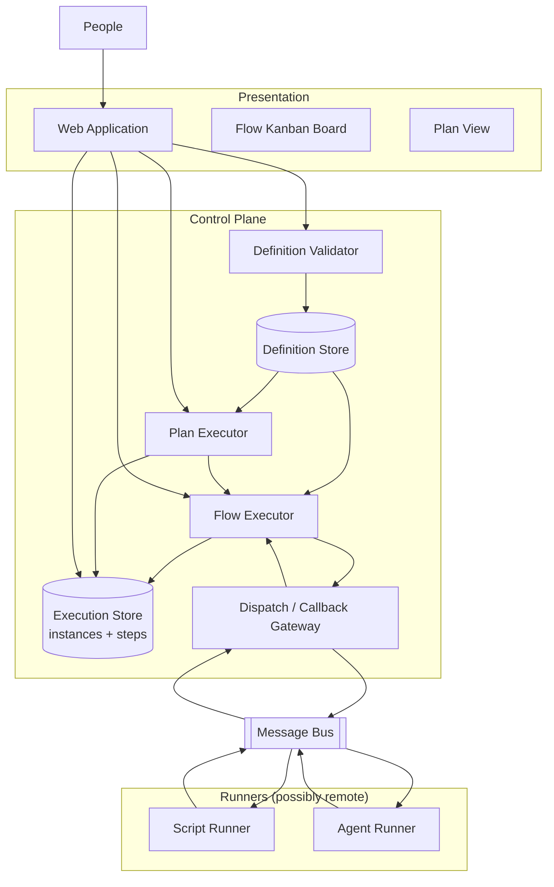

# Architecture: Flow Execution Platform

This document describes the key components of the platform and how they fit together. It
builds on `vision.md`: the platform applies one idea — a definition of ordered units, an
executor that runs them, a step history that lives with the instance — at two levels, **Plan** and
**Flow**.

The architecture is deliberately split into a **control plane** (definitions, executors,
state) and **runners** that may execute on other machines, connected by a **message bus**.

---

## Component overview

---

## Key components

### 1. Definition Store

Holds **plan definitions** and **flow definitions** as JSON, together with their versions.

- A plan definition is a set of nodes, each pairing a material goal with the flow that should
  achieve it; each node names its successor(s) via `next` — a bare string or array for a single
  outcome (one or parallel), or a label map — so order, parallelism, and error routing are
  explicit.
- A flow definition groups nodes (steps) into stages and substages; each node names its
  successors the same way. The grouping is logical, while `next` defines order, branching, and
  error routing.
- Definitions are immutable-by-version: a run always refers to the exact version it started
  with.
- The store is the source of truth for *what should run*, never for *what is running*.

### 2. Definition Validator

Checks every definition against its schema before it is stored or used.

- Rejects invalid definitions early; nothing runs against them.
- Guarantees the executor can rely on the shape of what it loads.
- Can be used by the web application for live validation while authoring.

### 3. Plan Executor

Orchestrates **flow instances** as the units of a larger initiative.

- Loads a plan definition and starts a **plan instance**.
- Creates a flow instance for each plan node's goal, tracks whether it is running, paused, or
  ended, and follows the node's `next` label to the next node.
- Follows every target of a label; an array of targets runs flows in parallel.
- Treats each flow as a black box: it does not inspect the steps inside.
- Records its own decisions and progress in the plan instance's steps.

### 4. Flow Executor

Orchestrates the **steps** of a single flow.

- Loads a flow definition and starts a **flow instance**.
- Owns the step state machine: running, paused, ended. A human step stays running until the
  person responds.
- Dispatches `script` and `agent` steps through the dispatch gateway; waits for `human`
  steps to be resolved through the web application.
- On a positive outcome, follows a bare `next` directly (a string to one node, an array to
  several in parallel), or uses the node's `label` to look up successors in a map.
- Receives an **Error** object from a failed node and uses its `code` as the label to find the
  next node. Nodes fail fast; there are no retries.
- Pauses the flow on an unexpected (unrouted) error or label and surfaces it for intervention.
- Appends everything that happens to the flow instance's steps.

### 5. Step Runners

Execute the work that the flow hands off.

- **Script runner** — runs software: a job, container, or command.
- **Agent runner** — runs an AI agent against a one-shot instruction.
- Runners may live on other machines, which is why all communication goes over the bus.
- Each runner receives a **correlation ID**, does its work, and reports the outcome and error
  back via callback.
- Runners are stateless from the platform's point of view: any runner can handle any
  dispatch it receives.

### 6. Dispatch / Callback Gateway

The boundary between the executors and the message bus.

- Turns a step handoff into a dispatch message, including run, step, and correlation IDs.
- Accepts callbacks, matches them to the outstanding step by correlation ID, and hands the
  result to the flow executor.
- Absorbs late, duplicate, or unknown callbacks without corrupting flow state.

**MVP simplification:** for the first version, callbacks are skipped entirely. The flow
executor runs script and agent steps locally and takes the result inline via a **direct local
shell call**. The gateway, message bus, and correlation IDs are introduced when execution
moves off the local machine.

### 7. Message Bus

The connective tissue across the machine boundary.

- Carries dispatches to runners and callbacks back to the platform.
- Decouples the control plane from where the work actually executes.
- Makes the platform independent of a runner's location or availability.
- Not present in the **MVP**, where local shell calls replace the gateway and bus.

### 8. Execution Store

Holds **execution instances** and their steps — not definitions.

- A **flow instance** contains the goal it was started for and its steps.
- A **plan instance** contains the states of its flow instances and its own steps.
- Steps are part of the instance: the store persists them together so the run can
  always be replayed and presented.
- This is the source of truth for *what happened*.

### 9. Human Task Surface

The web application's handling of `human` steps.

- Presents the step, its inputs, and any context a person needs.
- Accepts the person's decision or result and resolves the step in the flow executor.
- Keeps human work on the same lifecycle and steps as script and agent work.

### 10. Presentation Layer

The human window into both levels, reading from the execution store.

- **Web application** — definitions, execution status, and operator actions.
- **Flow kanban board** — steps by type and state, with columns for Human, Script, Agent,
  Paused / Blocked, and Ended.
- **Plan view** — plan nodes and the flow instances created for their goals, their order and
  parallelism, progress, and drill-down into the underlying flow and steps.
- Operator actions go back to the executors, not directly to the store.

---

## Responsibility boundaries

| Component            | Owns                                        | Does not own                          |
|----------------------|---------------------------------------------|---------------------------------------|
| Definition Store     | Plan and flow definitions, versions         | Execution state                       |
| Definition Validator | Schema conformance                          | Execution decisions                   |
| Plan Executor        | Sequencing flow instances                   | Steps inside a flow                   |
| Flow Executor        | Step lifecycle and error routing            | Executing script/agent work           |
| Step Runners         | Doing the work, reporting outcome/error     | Flow state, routing                   |
| Gateway / Bus        | Transport, correlation, delivery            | Business decisions                    |
| Execution Store      | Instances and their steps                   | Definitions                           |
| Presentation         | Showing state, collecting human input       | Owning execution state                |

---

## Key interactions

### Authoring

1. A user edits a plan or flow definition in the web application.
2. The validator checks it against the schema and reports problems live.
3. A valid definition is stored as a new immutable version.

### Running a plan

1. The plan executor loads a plan definition and creates a plan instance.
2. It starts the flow instances at the plan's entry nodes.
3. A bare array, or a label whose value is an array, fans out to flows that run in parallel;
   different labels select different branches.
4. As flows finish, the plan follows the applicable `next` to the next ones and records
   progress in its steps.

### Running a flow with script or agent steps

1. The flow executor reaches a step and hands it to the dispatch gateway.
2. The gateway publishes a dispatch with a correlation ID to the message bus.
3. A runner picks it up, executes, and publishes a callback.
4. The gateway matches the callback to the step and delivers it to the flow executor.
5. The flow executor updates the step, appends to the instance steps, and continues.

### Running a human step

1. The flow executor marks the human step running and exposes it through the web application.
2. A person acts on it.
3. The web application resolves the step in the flow executor, which continues the flow.

### Error handling

1. A node manages what it can, then fails fast and reports an **Error** object.
2. The flow executor uses the error's `code` as a label to find the next node.
3. An unrouted (unexpected) error pauses the flow for human intervention.
4. A paused flow is visible on the kanban board and, at the plan level, to the plan instance.

### Observing

1. The presentation reads instances and their steps from the execution store.
2. It shows status at both levels and the history of what happened.
3. Operator actions are sent to the executors to change state.

---

## Deployment shape

- The **control plane** (validators, executors, store, presentation) can run together or be
  scaled independently.
- **Runners** are separate and may be distributed across machines, connected only through
  the bus.
- The **message bus** is the only path between the control plane and runners, so neither side
  needs to know where the other lives.
- Flow and plan instances are durable, so executors can pause or restart without losing the
  run.
- In the **MVP**, everything runs locally: script and agent steps are executed by a direct
  local shell call instead of being dispatched over the bus, so there is no separate runner
  tier yet.

---

## Open decisions

- Choice of message bus and delivery semantics.
- Choice of persistent store for definitions and instances.
- How much the platform minimizes resident resources (see `vision.md` §5).
- Whether plan and flow views share one board implementation or are distinct.

See `data-model.md` for the concrete definitions, instances, callbacks, and step types.
